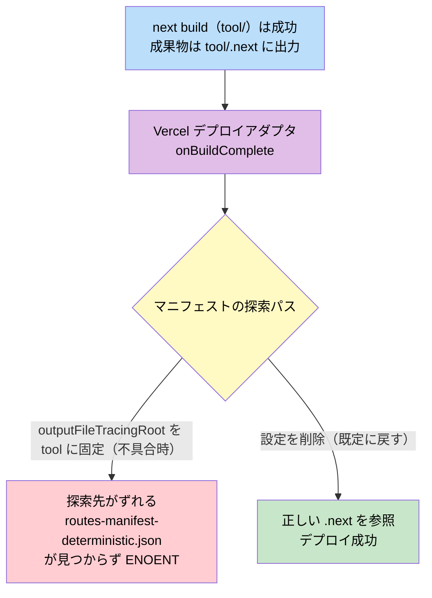
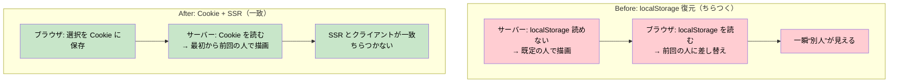
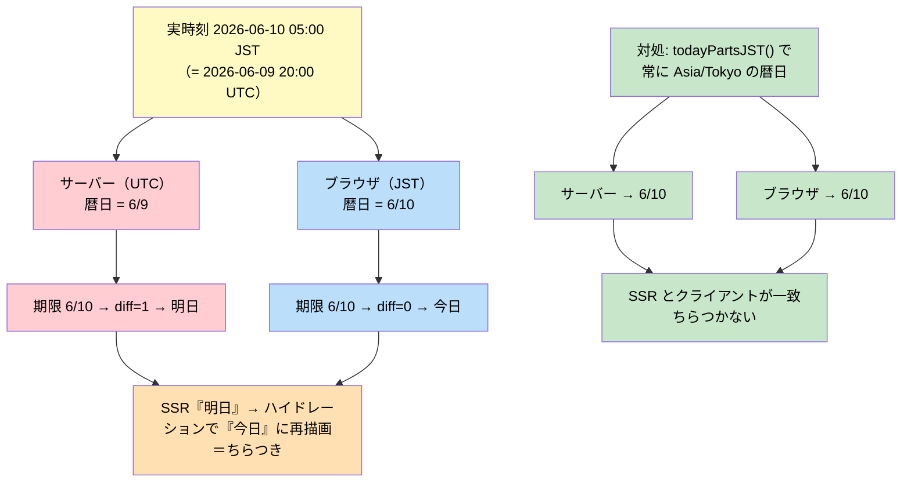
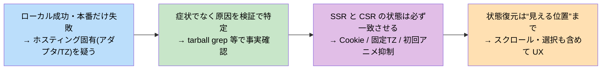

# 08_修正・トラブルシュート記録

第7回宿題（Notion 永続化 + Vercel 公開、2026-06-08〜10）で遭遇した不具合と、その**症状 → 原因 → 対処 → 学び**をまとめた記録。再発防止と、同種スタック（Next.js 16 + Notion + Vercel）での参照用。

> 関連: 設計判断は [03_データ設計書.md](03_データ設計書.md)、工夫の総覧は [07_工夫したポイント.md](07_工夫したポイント.md)、時系列の作業ログは [../notes/2026-06-08_session-record.md](../notes/2026-06-08_session-record.md)。

---

## 0. 一覧（サマリ）

| # | 症状 | 真因 | 対処 | commit |
|---|------|------|------|--------|
| 1 | Vercel デプロイが連続失敗（`routes-manifest-deterministic.json` ENOENT） | `next.config` の `outputFileTracingRoot` をサブディレクトリに固定 | 設定を削除 | `2950b8b` |
| 2 | 編集してもリロードで消える | 永続化が未配線（見た目だけ） | Server Action で Notion 書込を配線（Phase C/D） | `5d7f9c5` / `9074939` |
| 3 | 別端末・リロードで最新が出ない | 静的プリレンダーでビルド時データが焼き込み | `force-dynamic` で毎リクエスト取得 | `38e6a1e` |
| 4 | 起動時にバナー誤表示＋必ず同じ人（高田美咲）から開始 | 選択中IDが旧JSONの `"c2"` 固定で実在しない | 既定を「最近触った人」算出に変更 | `f033a55` |
| 5 | リロードで一瞬「別人」が見える | localStorage 復元の二段階描画 | Cookie + SSR で初期選択を一致 | `2f3c695` |
| 6 | リロードで中身がフェードして「2回表示」に見える | 入場アニメが初回マウントでも発火 | 「切替時のみ」アニメに限定 | `0c92e49` |
| 7 | 「今日」タグが一瞬「明日」になる | サーバー(UTC)とブラウザ(JST)で暦日がズレる | 「今日」を日本時間に統一 | `0faba77` |
| 8 | F5 で Pane2 が先頭に戻る／復元してもズレる時がある | スクロール位置が非復元。さらに(保存遅延＋フォント遅延)で間欠的にズレ | スクロール位置を Cookie 保存＋初回描画前スクリプトで復元。離脱直前保存＋フォント確定後の補正でズレ解消 | `6a64339` / `d4d0fc2` / `116e44e` |
| 9 | 保存（接触ログ等）後に一瞬ちらつく＝実質リロード | 各 Server Action の `revalidatePath("/")` が保存毎にルート再取得 | revalidatePath を全廃（楽観更新＋force-dynamic で十分） | `3b69d87` |

ほとんどが **「ローカルでは再現せず、本番(SSR)だけで起きる」** か **「サーバーとクライアントで状態がズレる(ハイドレーション)」** に分類される。以下、難所順に詳述する。

---

## 1. Vercel デプロイが連続失敗 — 真因は `outputFileTracingRoot`

### 症状
ローカルの `next build` は成功するのに、Vercel だけ次のエラーでデプロイ失敗：

```
ENOENT: no such file or directory, lstat '/vercel/path0/.next/routes-manifest-deterministic.json'
```

ビルド（コンパイル・型チェック・ページ生成）は毎回成功し、最後の **`onBuildComplete from Vercel`**（Vercel のデプロイアダプタ）の段階だけで落ちる。

### 切り分け（やったこと）
1. bundler を疑い `next build --webpack` に変更 → **変化なし**（`975d621`、空振り）
2. 環境変数 / Root Directory / 「Include files outside root」OFF → **変化なし**
3. `routes-manifest-deterministic.json` という文字列を **Next 16.2.6 / 16.2.7 / 16.3canary の tarball を展開して `grep`** → **どのバージョンにも存在しない**ことを実証
   → このファイルは Next 本体由来ではなく、**Vercel のデプロイアダプタ（Next 16.2 で安定化した Adapters API の `onBuildComplete`）が扱う成果物**と判明
4. 公式情報・報告事例「Vercel の routes-manifest ENOENT は `next.config` の `outputFileTracingRoot` を削除したら直る」に合致

### 原因
アプリは `repo/tool/` のサブディレクトリにある。`next.config.ts` が `outputFileTracingRoot` を `tool` に固定していたため、Vercel アダプタのマニフェスト探索パスがずれ、`.next` を見つけられなかった。**ローカルではアダプタが走らないので再現しない。**



### 対処
`next.config.ts` から `outputFileTracingRoot` の行を削除（`2950b8b`）。親階層に lockfile が無く、この設定は元々不要だった。

### 学び
- **謎マニフェストの ENOENT は、まずそのファイル名が Next 本体に在るかを tarball を grep して確認する**（Next 由来か、ホスティング側アダプタ由来かを切り分ける）。
- 当て推量で bundler や env を変えるより、**事実を1つずつ検証**する方が結局速い。

---

## 2〜3. 永続化と「常に最新」 — Phase C/D と force-dynamic

### 症状
- 候補者を編集してもリロードで元に戻る（データがブラウザのメモリだけ）。
- 公開後、別端末で開くと古いデータが出る。

### 原因
- 編集が Notion に書かれていない（見た目だけの段階）。
- トップページが静的プリレンダーで、ビルド時の Notion データが焼き込まれていた。

### 対処
- **Phase C/D**: 進捗ステージ・プロフィール・評価4軸・アーカイブ・接触ログ追加を Server Action（`app/actions.ts`）から `notion.pages.update` / `pages.create` で書込。楽観的更新＋失敗ロールバック＋トースト、接触ログは `useOptimistic`、全書込は直列化（`5d7f9c5` / `9074939`）。
- **`export const dynamic = "force-dynamic"`** で毎リクエスト Notion から取得（`38e6a1e`）。

### 学び
- 「リロードで残る／別端末で同じ」を満たすには、**書込（永続化）と読取（毎回取得）の両輪**が要る。詳細は [03_データ設計書.md](03_データ設計書.md)。

---

## 4〜5. 初期選択 — ハードコード廃止と Cookie + SSR

### 症状
1. 起動直後に「この候補者は現在の絞り込み / 検索結果に含まれていません」バナーが誤表示。
2. リロードすると必ず同じ人（高田美咲）から始まる。
3. （`f033a55` 適用後）リロード時に一瞬「別人」が見えてから前回の人に切り替わる。

### 原因
- 選択中IDの初期値が**旧 JSON 時代の `"c2"` 固定**で、Notion 由来の UUID には存在しない。
  - 存在しない → 表示リストに無い → バナーが「含まれない」と誤判定（症状1）
  - 存在しない → `candidates[0]`（＝高田美咲）にフォールバック（症状2）
- それを localStorage で復元する方式にすると、**サーバーは localStorage を読めない**ため二段階描画になる（症状3）。



### 対処
- ハードコードを廃止し、初期選択を **`pickDefaultCandidateId`（最終連絡日が最新の非アーカイブ＝最近触った人、無ければ非アーカイブ先頭）** で決定的に算出（`f033a55`）。これで実在しないID由来のバナー誤表示と「常に高田美咲」が解消。
- 前回選択は **Cookie（`pns_selected`）に保存し、Server Component（`app/page.tsx`）が SSR 時に読んで初期選択に反映**（`2f3c695`、`lib/selection.ts`）。SSR とクライアントの初期値が一致するためちらつかない。

### 学び
- **「前回の状態を SSR でも復元したい」なら localStorage ではなく Cookie**。localStorage はクライアント専用で、SSR と必ず二段階になる。

---

## 6. 入場アニメによる「2回表示」 — 切替時のみに限定

### 症状
F5 でリロードすると、Pane3（候補者詳細）の中身がフェードインし、「一瞬ちらついて人が出る＝2回表示される」ように見える。

### 原因
Pane3 / Pane4 のコンテンツに入場アニメ `animate-in fade-in` が付いており、`key`（選択候補者・タブ）が変わるたびに発火する設計だった。**ページ再読み込み時も「初回マウント」として発火**するため、リロードのたびにフェードしていた。

### 対処
`useAnimateOnChange` フックを追加し、**初回レンダー（SSR / ハイドレーション直後）は false（アニメ無し）で即時表示**、値が変わった後続レンダー（＝ユーザーの切替）でのみ true でフェードさせる（`0c92e49`）。SSR と初回がともに false なのでハイドレーション不一致も起きない。

### 学び
- **入場アニメ＋SSR は、初回ロードでもアニメが走り「ちらつき」になる**。「変化時だけ」アニメさせる切り分けが要る。

---

## 7. 「今日」タグが一瞬「明日」 — タイムゾーン統一

### 症状
Pane2 の期限バッジ「今日 / 明日 / あとN日」が、リロード直後に一瞬「明日」と出てから「今日」に変わる。

### 原因
期限・最終接触などの日付ヘルパーが `new Date()` の**実行環境ローカル**で「今日」を算出していた。**サーバー（Vercel）= UTC、ブラウザ（日本）= JST** のため、JST 0〜9時はUTCだと前日になり、サーバーとクライアントで暦日が1日ズレる。SSR が「明日」を描画 → クライアントが「今日」に再計算＝ハイドレーション時のちらつき。



### 対処
`todayPartsJST()`（`Intl.DateTimeFormat` で Asia/Tokyo の暦日を返す）を追加し、`getDeadlineBadge` / `getLastContactBadge` / `dateNDaysAgo` の「今日」を JST 基準に統一（`0faba77`）。回帰防止に JST 境界のテストを3件追加。

### 学び
- **SSR アプリで `new Date()` の暦日を表示に使うと、サーバーTZ(UTC)とユーザーTZ(JST)でズレてちらつく**。表示の基準日は**固定TZ（業務上の地域＝日本）で算出**して SSR/CSR を一致させる。

---

## 8. F5 で Pane2 が先頭に戻る／復元してもズレる — スクロール位置の正確復元

### 症状（段階的に判明）
1. リロードすると Pane2（候補者リスト）が一番上に戻り、前回見ていた人が画面外になる。
2. （初回対処後）`scrollIntoView` で「一瞬先頭→対象者へ移動」のフラッシュが見える。
3. （位置復元化後）`block:"nearest"` だと対象者が画面**下端**に張り付く。
4. （`center` 化後）「**前回の位置をそのまま**保ちたい」。さらに、復元しても**ズレる時とズレない時**がある。

### 原因
- 再読み込みでスクロール位置がリセットされる（ブラウザ標準挙動）。
- `useEffect` での復元は「SSR が先頭で描画 → JS 後にスクロール」で一瞬先頭が見える。
- 間欠ズレの2要因: **(A) 保存が 150ms debounce のみ** → スクロール直後に reload すると Cookie が古い。**(B) `Inter` フォント(`display:swap`)の遅延読み込み**で行高が変わり、描画前に設定した `scrollTop` がフォント適用後にズレる（キャッシュ有無で間欠的）。

### 対処（最終形）
- **保存**: Pane2 ビューポートの `scrollTop` を Cookie（`pns_pane2_scroll`）に保存。スクロール追従（100ms debounce）＋ **離脱直前（`pagehide` / `visibilitychange`）に必ず保存**＝reload 時に常に最新（`d4d0fc2` / `116e44e`）。
- **復元**: 初回 HTML 描画より前のインラインスクリプト（`app/page.tsx`）が Cookie を読んで `scrollTop` を復元 → フラッシュなし（`6a64339`）。Cookie が無い初回のみ、選択行を `scrollIntoView({block:"center"})` でフォールバック。
- **補正**: `document.fonts.ready` 後に保存値を1回だけ再適用（差が1px超の時のみ＝ズレていなければ何もしない）＝フォント遅延のズレを吸収（`116e44e`）。
- 選択行特定用に `SortableCandidateRow` へ `data-candidate-id` / `data-selected`、ScrollArea に `id`、Cookie/ID 名は `lib/selection.ts` に集約。

### 学び
- **スクロール位置の復元は「初回描画より前」に行う**（`useEffect` 後だと先頭が一瞬見える）。
- **位置(px)復元は後続のレイアウトシフトに弱い**。保存は離脱直前に確実化し、フォント等の確定後に再補正する二段構えが要る。

---

## 9. 保存後の一瞬のちらつき — revalidatePath を全廃

### 症状
接触ログなどを保存した直後、画面が一瞬ちらつく（「保存してリロードしている？」と感じる）。

### 原因
各 Server Action（`updateStageAction` 等）が末尾で `revalidatePath("/")` を呼んでおり、**保存のたびにルートをサーバー再取得（実質リロード）**していた。接触ログ保存はさらにログ再取得もするため特に目立った。

### 対処
全アクションから `revalidatePath` を削除（`3b69d87`）。クライアントは楽観的更新で即時反映済みで、ページは `force-dynamic` のため**次のリロードで毎回 Notion から最新取得**される（別端末同期も force-dynamic が担う）。よって revalidatePath は冗長で、ちらつきの唯一の原因だった。

### 学び
- **楽観的更新＋`force-dynamic` の構成では `revalidatePath` は不要**。むしろ保存毎のルート再取得でちらつきを生む。「最新を見せる」手段が二重化していないか点検する。

---

## まとめ — 横断する教訓



1. **ローカルで再現しない不具合は、ホスティング/実行環境固有の差（デプロイアダプタ・タイムゾーン・SSR）を疑う。**
2. **当て推量で直さず、事実を1つずつ検証して真因を特定する。**
3. **SSR とクライアントの「初期状態」は必ず一致させる**（Cookie で復元・固定TZで日付算出・初回はアニメさせない）。一致しないと必ずちらつく。
4. **状態の復元は「見える位置」まで含める**（選択の復元＋その行までスクロール）。

---

- 前: [07_工夫したポイント.md](07_工夫したポイント.md)（設計・実装でこだわった16点）
- index に戻る: [README.md](README.md) / [../README.md](../README.md)
